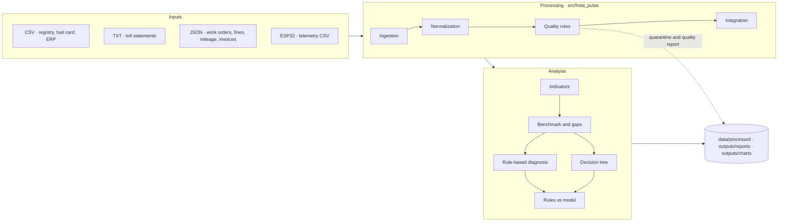

<p align="center"><a href="README.md">Português</a> · <b>English</b></p>

# Frota Pulse, Sprint 2: fleet-cost intelligence and diagnosis

A local Python pipeline that takes the files a fleet manager actually has, cleans them, compares each vehicle with similar ones and shows where money is being lost, with a rule-based diagnosis and a supervised model on engine telemetry.

> **Academic project.** FIAP Enterprise Challenge with Sem Parar Empresas, Artificial Intelligence degree, class 1TIAO. Team of five: Bruna Collavite, Fabio Guntovitch, Fabrizzio Riccelli, Gabriel Tamais and Natasha Zonta. **All data is simulated**: three fictitious fleets, no customer data. Frota Pulse is a working name, not an official product.
>
> Sprint 1, with the problem, the data model and the product specification, is in [frota-pulse-sprint-1](https://github.com/fabrizzioriccelli/frota-pulse-sprint-1). Sprint 2 video: [YouTube, unlisted](https://youtu.be/qQmlMtQE0gA).

## Problem

"The manager knows how much was spent, but not where money is being lost." Fuel, maintenance, tolls, fines and taxes arrive from different systems, in different formats and units. A high total cost does not mean waste: a vehicle that drives more costs more. What the manager lacks is a fair comparison and a list of where to act first.

## What Sprint 2 delivers

| Step | What it does |
|---|---|
| Ingestion and normalization | Reads 12 files in CSV, TXT and JSON that imitate a fuel card, a toll tag, workshops, an ERP and a telematics provider. One schema, strict dates, consistent units, six cost categories |
| Data quality | 17 rules find duplicates, negative values, empty fields, unknown vehicles, invalid dates, incompatible units and inconsistent readings. **Nothing is deleted**: each issue becomes a report line with file, row, treatment and reason |
| Integration | Joins registry, costs, mileage and telemetry by vehicle and month |
| ESP32 telemetry | Speed, RPM, temperature and fuel level as virtual inputs on Wokwi, with LED, buzzer and serial alerts. The same firmware, compiled natively, generates 52,020 readings for the pipeline |
| Benchmark and gap | Groups of the same size, operation and category; the median as reference; a gap where positive always means worse |
| Rule-based diagnosis | Efficient, Attention, Inefficient or No reference, with thresholds justified by the data distribution |
| Supervised model | A decision tree that anticipates, from telemetry, the months in which fuel consumption will be worse than the reference, compared with the rules |



## Results on simulated data

Three fictitious fleets, 78 vehicles: 75,413 records read, 452 quality issues logged, R$ 18.99 million in consolidated cost. Diagnosis: 44 efficient, 20 attention, 6 inefficient and 8 without a valid reference.

| Model (decision tree) | |
|---|---|
| Unit | Vehicle-month: 835 rows from 70 vehicles |
| Label | Monthly consumption more than 5% worse than the group median (26% of cases) |
| Features | Share of time above the green RPM band, idling, speeding, average speed, alerts, max temperature, age and group |
| Split | 30% of the vehicles in each group held out, fixed seed; no vehicle on both sides |
| Test | Accuracy **82.8%** (baseline 73.6%), recall 72.7%, precision 65.8% |

Idling accounts for 63% of the feature importance, followed by high RPM (20%). Rules and model agree on 18 of 21 test vehicles. The three disagreements are explained by low utilization or maintenance, which telemetry cannot see.

## Technical decisions

- **Local pipeline, no database or cloud.** The sprint asks for intelligence and diagnosis; infrastructure now would only add failure points. Each step reads and writes files and follows the Sprint 1 architecture.
- **Read everything as text, delete nothing.** The original value sits next to the treated one, and every record keeps its source file and row.
- **Compare only what is comparable.** Groups by size, operation and category, at least five vehicles each; leased vehicles are kept out of total cost because the lease already includes maintenance and insurance.
- **The model predicts what telemetry can see.** The first target, the full cost rule, was dropped because telemetry cannot anticipate maintenance invoices. The adopted target is monthly fuel consumption ([details, in Portuguese](docs/machine-learning.md)).
- **Split by vehicle**, so the model is evaluated on vehicles it has never seen.
- **One firmware for Wokwi and the pipeline.** The pseudo-random generator lives in the firmware, so the simulated ESP32 and the native build produce the same readings, checked by a test.

## Getting started

Requires Python 3.11 or newer.

```bash
git clone https://github.com/fabrizzioriccelli/frota-pulse-sprint-2.git
cd frota-pulse-sprint-2
python -m venv .venv && source .venv/bin/activate   # Windows: .venv\Scripts\activate
pip install -r requirements.txt

python src/executar_pipeline.py   # all 11 steps, about 5 seconds
python -m pytest -q               # 42 tests, including checks on this documentation
```

Results are written to `outputs/reports/resultados_sprint2.md`. The notebook [`notebooks/sprint2_demonstracao.ipynb`](notebooks/sprint2_demonstracao.ipynb) runs the steps one by one. Wokwi instructions are in [`docs/telemetria-esp32.md`](docs/telemetria-esp32.md).

## Project structure

```text
data/raw/          input files, never modified
data/telemetria/   ESP32 serial output as CSV
data/processed/    treated tables, quarantine and the consolidated vehicle-month base
outputs/           quality reports, benchmarks, rankings, diagnosis, predictions and charts
src/frota_pulse/   one module per pipeline step
src/esp32/         firmware, Wokwi project and native build
src/simulacao/     generator of the raw sources and their inconsistencies
docs/              methodology, architecture, model, telemetry, tests and evidence
tests/             pytest suite
```

## Limitations and next steps

- Everything runs on simulated data, so the numbers demonstrate the method, not real fleets.
- Re-running the pipeline changes a few values at the last decimal place in three output files and the timings in the log; the metrics and the diagnosis do not change.
- Savings in reais, recommendations and reading PDFs and images are planned for Sprint 3.
