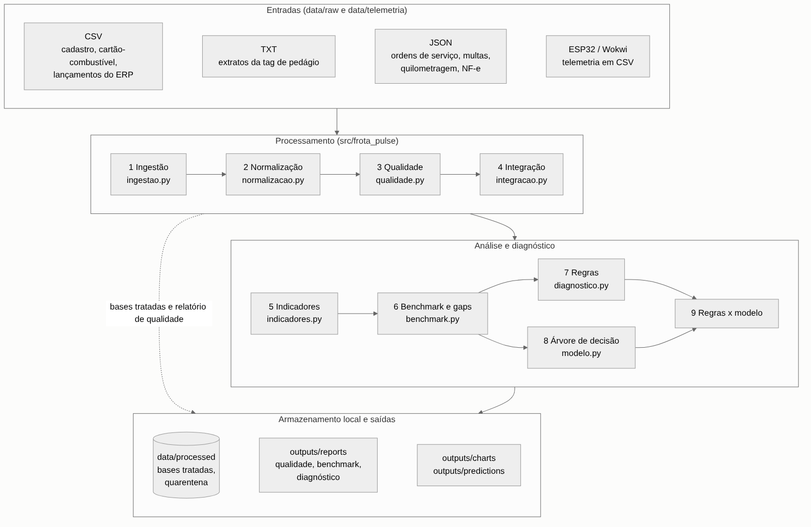

# Arquitetura da Sprint 2

A Sprint 2 implementa, em Python e localmente, a parte de dados e análise da arquitetura proposta na Sprint 1 ([docs/arquitetura.md](https://github.com/fabrizzioriccelli/1TIAO-ENTERPRISE-CHALLENGE-/blob/main/docs/arquitetura.md)). Não há banco de dados, nuvem nem interface: as etapas leem arquivos, gravam arquivos e podem ser executadas por um único comando ou pelo notebook.

Fonte editável do diagrama: [imagens/arquitetura-sprint2.mmd](imagens/arquitetura-sprint2.mmd) (Mermaid).

## Fluxo

Arquivos de entrada → ingestão → normalização → verificação de qualidade → integração → indicadores → benchmark → gap de eficiência → diagnóstico por regras → Machine Learning → resultados.

| Etapa | Módulo | Entrada | Saída |
|---|---|---|---|
| 1. Ingestão | `src/frota_pulse/ingestao.py` | 12 arquivos em `data/raw/` e `data/telemetria/` | Um lote por arquivo: registros como texto, fonte, formato, hash SHA-256, linhas rejeitadas |
| 2. Normalização | `normalizacao.py` | Lotes | Tabelas canônicas: veículos, custos, quilometragem, telemetria |
| 3. Qualidade | `qualidade.py` | Tabelas canônicas | Tabelas com `status_qualidade` e `motivos`; relatório com uma linha por ocorrência |
| 4. Integração | `integracao.py` | Tabelas tratadas | Base veículo-mês (cadastro + custos rateados + km + telemetria) |
| 5. Indicadores | `indicadores.py` | Base veículo-mês | Custo total, custo por km, consumo, preço médio e participações, por veículo e por veículo-mês |
| 6. Benchmark e gaps | `benchmark.py` | Indicadores | Estatísticas por grupo (média, mediana, quartis) e gaps absoluto e percentual com direção |
| 7. Regras | `diagnostico.py` | Gaps | Nível Eficiente, Atenção, Ineficiente ou Sem referência, com justificativa |
| 8. Modelo | `modelo.py` | Gaps mensais e telemetria | Árvore de decisão, métricas, previsões, exemplos |
| 9. Comparação | `modelo.py` | Regras e previsões | Concordâncias, divergências e interpretação |
| Orquestração | `src/executar_pipeline.py` | - | Grava `data/processed/`, `outputs/reports/`, `outputs/charts/` e `outputs/predictions/` |

## Separação de responsabilidades

| Camada | Pasta ou módulo | Responsabilidade |
|---|---|---|
| Dados | `data/raw/`, `data/telemetria/`, `data/processed/` | Originais intactos; tratados separados; quarentena em arquivo próprio |
| Processamento | `ingestao.py`, `normalizacao.py`, `qualidade.py`, `integracao.py` | Ler, padronizar, verificar e juntar; nenhuma regra de negócio aqui |
| Análise | `indicadores.py`, `benchmark.py` | Fórmulas e estatísticas |
| Regras de negócio e diagnóstico | `diagnostico.py`, `config.py` | Limites, níveis e justificativas; todos os limites ficam em `config.py` |
| Machine Learning | `modelo.py` | Preparação, separação treino/teste, treino, avaliação e comparação |
| Comunicação | `graficos.py`, `relatorios.py` | Gráficos e relatórios gerados dos resultados, sem números digitados à mão |
| Dispositivo | `src/esp32/` | Firmware do ESP32, projeto Wokwi e compilação nativa para gerar o CSV |
| Simulação | `src/simulacao/` | Geração das fontes brutas e dos perfis de telemetria a partir da massa da Sprint 1 |

## Tecnologias

| Tecnologia | Versão testada | Uso |
|---|---|---|
| Python | 3.13 | Pipeline, simulação, testes |
| pandas e NumPy | 3.0 e 2.5 | Leitura, transformação e cálculo |
| scikit-learn | 1.9 | Árvore de decisão, regressão logística e floresta aleatória (comparação) |
| matplotlib | 3.11 | Gráficos |
| pytest | 9.1 | Testes automatizados |
| C++ (Arduino) para ESP32 | - | Firmware; no Wokwi e compilado com g++ para o modo lote |
| Wokwi | - | Simulação do circuito do ESP32 |
| Mermaid | - | Diagrama de arquitetura |

## Evolução prevista

Na Sprint 3, a mesma estrutura recebe a extração de PDF e imagem (antes da etapa 2), o cálculo de economia em reais e o motor de recomendações (depois da etapa 7), sem mudar as etapas existentes.
