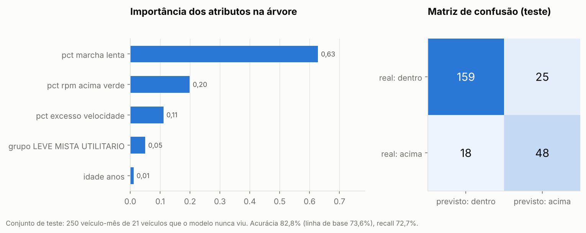
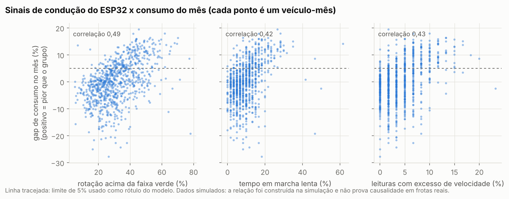

# Modelo supervisionado: alerta de consumo pela telemetria

Implementação: `src/frota_pulse/modelo.py`. Resultados: `outputs/predictions/` e seção 5 de `outputs/reports/resultados_sprint2.md`. Todos os números vêm de **dados simulados**.

## 1. Para que serve o modelo

O consumo real (km/L) de um veículo só é conhecido quando o extrato do cartão-combustível fecha o mês. A telemetria do ESP32 chega no mesmo dia. O modelo aprende, nos sinais de condução, o padrão dos meses em que o consumo ficou acima da referência do grupo, e serve como **alerta antecipado**.

Ele também ajuda o diagnóstico a separar duas causas que as regras não distinguem sozinhas: ineficiência de **condução** (visível na telemetria) e ineficiência de **custo** (manutenção, pedágio, preço, baixa utilização), que a telemetria não enxerga. O modelo não substitui as regras: quando os custos chegam, são elas que classificam o veículo.

## 2. Unidade, rótulo e atributos

| Elemento | Definição |
|---|---|
| Unidade | Veículo-mês com telemetria, km, litros e grupo com referência válida: 835 linhas de 70 veículos |
| Rótulo (y) | 1 = consumo do mês mais de 5% pior que a mediana do grupo no mesmo mês (o limite de "Atenção" das regras); 0 = dentro da variação típica ou melhor. Proporção de 1: 26% |
| Atributos (X) | Da telemetria do ESP32, no mês: % de leituras com rotação acima da faixa verde, % em marcha lenta, % com excesso de velocidade, velocidade média, alertas de temperatura, temperatura máxima. Do cadastro: idade do veículo e grupo (variáveis indicadoras) |
| Nunca entram | Custo, litros, km/L, preço, gaps e níveis das regras: são eles que formam o rótulo (o código recusa esses nomes) |

**Como o rótulo é construído:** para cada veículo-mês, calcula-se o km/L do mês, a mediana do km/L dos veículos do mesmo grupo no mesmo mês e o gap percentual (mediana − veículo) ÷ mediana × 100. O rótulo é 1 quando o gap passa de 5%.

## 3. Separação entre treino e teste

A separação é feita **por veículo**: 30% dos veículos de cada grupo vão para teste, sorteados com semente fixa (42), e todos os meses de um veículo ficam do mesmo lado. São 585 veículo-mês de 49 veículos no treino e 250 de 21 veículos no teste. Separar por linha deixaria meses do mesmo veículo nos dois lados, e o modelo seria avaliado em veículos que já viu: o acerto ficaria artificialmente alto (vazamento de dados). O teste `test_treino_e_teste_nao_compartilham_veiculos` garante a separação.

## 4. Escolha do modelo

Três algoritmos introdutórios foram treinados e avaliados no mesmo teste:

| Modelo | Acurácia | Acurácia balanceada | Precisão (consumo acima) | Recall (consumo acima) |
|---|---|---|---|---|
| Árvore de decisão (profundidade 3) | 82,8% | 79,6% | 65,8% | 72,7% |
| Regressão logística | 84,8% | 84,3% | 67,1% | 83,3% |
| Floresta aleatória (200 árvores) | 83,2% | 83,2% | 64,0% | 83,3% |

A **árvore de decisão** foi escolhida. A regressão logística acertou 2 pontos a mais, mas a diferença corresponde a cerca de 5 veículo-mês em 250, de apenas 21 veículos, e está dentro da incerteza de uma amostra desse tamanho. A árvore produz regras que o gestor consegue ler e conferir. Ela usa `class_weight="balanced"`, porque a classe positiva é minoritária, e `min_samples_leaf=10`, para não criar regras a partir de poucos casos.

## 5. Resultado

**Medida de acerto:** acurácia de 82,8% no teste. A linha de base, que sempre prevê "consumo dentro da referência", acertaria 73,6%. O modelo acerta mais que ela e, principalmente, encontra 72,7% dos meses de consumo ruim, que a linha de base nunca encontraria.

| | Previsto: dentro | Previsto: acima |
|---|---|---|
| **Real: dentro** | 159 | 25 |
| **Real: acima** | 18 | 48 |

**Regras aprendidas** (`outputs/predictions/arvore_decisao.txt`): o primeiro corte é a marcha lenta acima de 10,8% das leituras; depois vêm a rotação acima da faixa verde (30%) e o excesso de velocidade (7,5%). Marcha lenta responde por 63% da importância, rotação por 20% e excesso de velocidade por 11%. Faz sentido operacional: motor ligado com o veículo parado e rotação alta consomem combustível sem gerar quilometragem.

*Correlação entre cada sinal de condução e o gap de consumo do mês: 0,49 para rotação acima da faixa verde, 0,42 para marcha lenta e 0,43 para excesso de velocidade.*

## 6. Exemplos

Selecionados do conjunto de teste (`outputs/predictions/exemplos_previsoes_teste.csv`):

| Veículo e mês | Real | Previsto | Por quê |
|---|---|---|---|
| B-V05, dez/2025 | acima (gap +10,4%) | acima | Marcha lenta 13,3% e rotação acima da faixa verde 38,5%: os dois cortes da árvore |
| B-V08, out/2025 | dentro (+0,5%) | dentro | Marcha lenta 6,7%, sem excesso de velocidade relevante |
| B-V09, ago/2025 (erro) | dentro (−5,8%) | acima | Marcha lenta de 20% puxou a previsão, mas o consumo do mês ficou bom. O custo do mês, por outro lado, ficou 37% acima por manutenção: a telemetria viu algo diferente do normal, mas não no consumo |
| C-V30, mai/2026 (erro) | acima (+16,3%) | dentro | Marcha lenta de 8,3% e excesso de velocidade de 13,3% levaram ao ramo de idade, e a árvore aprendeu que veículos com mais de 6,5 anos (o C-V30 tem 8) ficam "dentro" nesse ramo. Uma árvore de 3 níveis simplifica combinações que existem nos dados |

## 7. Comparação com o diagnóstico por regras

Nos 21 veículos de teste, a leitura do modelo para o veículo é "condução ineficiente" quando ele previu consumo acima da referência em pelo menos metade dos meses. Essa leitura é comparada com o nível das regras (Atenção ou Ineficiente contra Eficiente). As duas abordagens **concordam em 18 dos 21 veículos (86%)**.

| Situação | Veículos | Interpretação |
|---|---|---|
| Regras e modelo apontam problema | B-V05, B-V15, C-V03, C-V30, C-V33 | Desvio com componente de condução; investigar hábitos de direção |
| Os dois dentro da referência | 13 veículos | Sem ação |
| Regras apontam, modelo não | B-V29 (Ineficiente), B-V12 (Atenção), C-V21 (Atenção) | A causa não é a condução: B-V29 roda pouco (custo fixo em poucos km), B-V12 tem manutenção acima do grupo e C-V21 consome um pouco mais sem sinal de condução fora do padrão |

As divergências são a parte mais útil da comparação. O modelo indica **onde** o problema não está: se a telemetria é normal e o custo é alto, o gestor deve olhar manutenção, utilização ou preço, e não o motorista.

## 8. Experimento descartado

O primeiro experimento usou como rótulo a regra mensal completa: "Ineficiente" se o pior gap de custo por km ou de consumo passasse de 15%. A árvore acertou 44,0% no teste, contra 72,8% da linha de base. O motivo: os atributos de telemetria têm correlação de apenas 0,03 com o gap de custo por km do mês, que oscila com faturas de manutenção e pedágio que nenhum sinal de condução antecipa, contra 0,4 a 0,5 com o gap de consumo. A conclusão orientou a escolha do alvo atual: o modelo deve prever o que os seus dados conseguem observar. Os dois experimentos estão em `outputs/predictions/metricas_modelo.json`.

## 9. Limitações

- **Relação construída na simulação.** Os perfis de condução do ESP32 foram sorteados a partir do rendimento de cada veículo-mês na massa da Sprint 1 (`src/simulacao/gerar_perfis_telemetria.py`). A ordem real é a inversa: a condução causa o consumo. O desempenho mostra que o pipeline funciona, mas **não prova** que esses sinais preveem consumo em frotas reais com essa precisão.
- **Amostra pequena.** São 21 veículos no teste. Um veículo a mais ou a menos muda a acurácia em alguns pontos; não há validação cruzada nesta Sprint.
- **Amostra de telemetria.** São 60 leituras por veículo-mês (1 hora simulada), e não o mês inteiro.
- **Um único limite.** O rótulo usa 5% para todos os grupos.
- **Uso.** O modelo gera um alerta para investigação, não uma decisão sobre o motorista.
