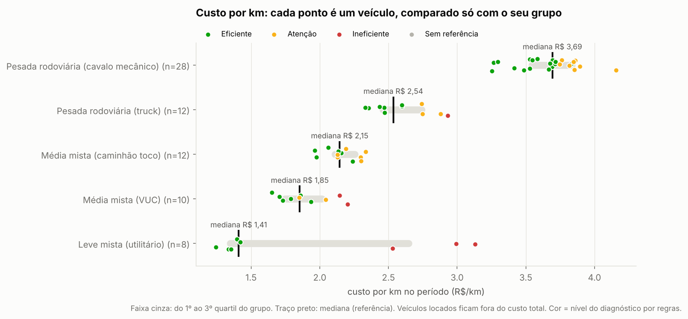
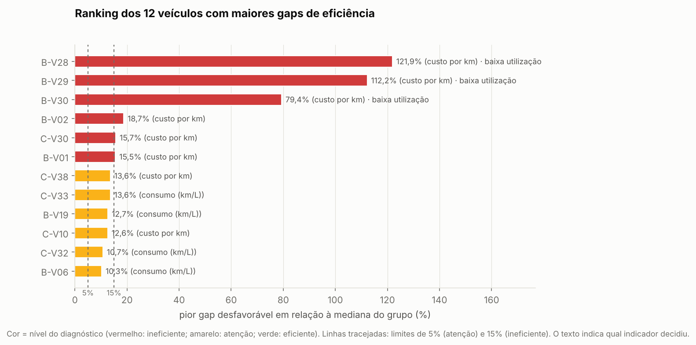
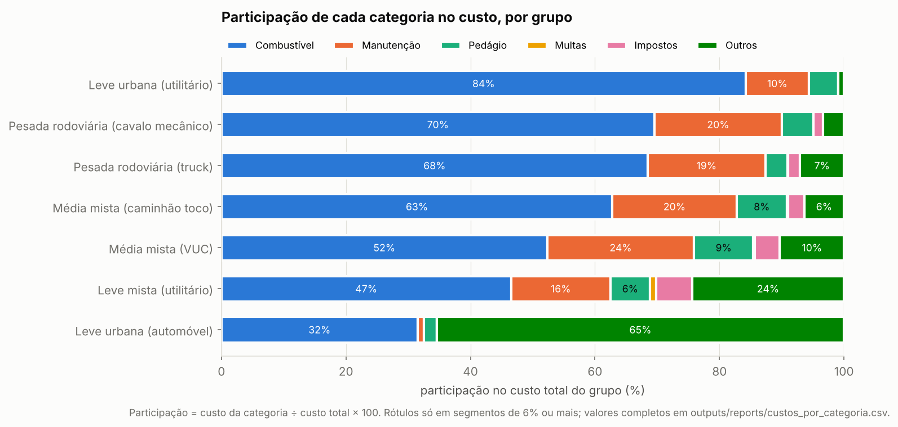

# Metodologia da Sprint 2

Como os dados entram, como são tratados e como cada número do diagnóstico é calculado. Todos os resultados citados vêm de `outputs/reports/resultados_sprint2.md`, gerado pelo pipeline sobre **dados simulados**.

## 1. Arquivos de entrada

Os arquivos imitam sistemas diferentes de um cliente real, cada um com nomes de colunas, separadores, formatos de data e unidades próprios. São gerados por `src/simulacao/gerar_fontes_brutas.py` a partir da massa da Sprint 1, e o ESP32 gera a telemetria.

| Arquivo | Formato | Origem simulada | Particularidades |
|---|---|---|---|
| `data/raw/cadastro/cadastro_frota.csv` | CSV, vírgula | Sistema de gestão da frota | Identificador comum `codigo_veiculo`; porte, operação, categoria, tanque |
| `data/raw/combustivel/abastecimentos_cartao.csv` | CSV, ponto e vírgula | Extrato do cartão-combustível | Decimal com vírgula; data dd/mm/aaaa hh:mm; compra ou estorno |
| `data/raw/combustivel/abastecimentos_cartao_reenvio_EMP-B_2026-03.csv` | CSV | O mesmo extrato, reenviado | Mesmas transações com identificadores novos |
| `data/raw/combustivel/notas_fiscais_combustivel.json` | JSON | NF-e recebidas por e-mail | Mesmas compras já presentes no cartão |
| `data/raw/pedagio/extrato_tag_EMP-*.txt` | TXT | Extrato da tag de pedágio | Campos separados por " \| ", cabeçalho e rodapé; "R$ 22,06"; pagador próprio ou embarcador |
| `data/raw/manutencao/ordens_servico.json` | JSON aninhado | Portal das oficinas | Cada ordem tem itens (peças, mão de obra) que precisam ser somados |
| `data/raw/multas/notificacoes_multas.json` | JSON | Notificações e pagamentos | Valor original e valor pago |
| `data/raw/financeiro/lancamentos_erp.csv` | CSV, vírgula | ERP financeiro | Categoria só no texto da conta; competência mm/aaaa; custo da frota sem veículo |
| `data/raw/operacao/quilometragem_telematica.json` | JSON | Telemática | Distância em **metros** |
| `data/telemetria/telemetria_esp32.csv` | CSV | Monitor Serial do ESP32 | 60 leituras por veículo-mês |

O dicionário dos campos de entrada e da base consolidada está em [data/dicionario-dados-sprint2.csv](../data/dicionario-dados-sprint2.csv).

## 2. Ingestão

Cada arquivo é lido **como texto**, sem converter nada, para que o relatório de qualidade possa mostrar o valor exatamente como veio. O leitor de CSV detecta o separador; o de TXT reconhece o cabeçalho e rejeita linhas fora do leiaute, registrando-as; o de JSON aceita lista ou objeto com lista e transforma itens aninhados em linhas. Todo registro recebe `_arquivo` e `_linha`, e cada arquivo tem o hash SHA-256 do conteúdo.

## 3. Normalização

| Aspecto | Regra |
|---|---|
| Colunas | Renomeadas para o esquema canônico: `veiculo_id`, `data_evento`, `competencia_inicio`, `competencia_fim`, `categoria`, `subcategoria`, `valor_brl`, `litros`, `preco_litro`, `odometro_km` |
| Identificador do veículo | Texto em maiúsculas e sem espaços; custo de frota (sem veículo) mantém o código da frota em `centro_custo` |
| Números | "R$ 1.234,56" e "1234.56" viram 1234.56; vazio vira ausente |
| Datas | Conversão estrita: "31/02/2026" não vira 03/03/2026, vira ausente, e o texto original é guardado |
| Competência | Mês a que o custo pertence, em AAAA-MM; impostos e seguro têm início e fim |
| Unidades | Distância de metros para km; volume em litros; valores em reais |
| Categorias | Seis categorias: Combustível, Manutenção, Pedágio, Multas, Impostos e Outros. Nos arquivos com categoria explícita, ela é usada; no ERP, a categoria vem do texto da conta (IPVA e licenciamento: Impostos; seguro, locação, lavagem, estacionamento e rastreamento: Outros) |
| Ausentes | Não são preenchidos aqui; a etapa de qualidade decide o tratamento |

## 4. Regras de qualidade

Nenhum registro é apagado. Cada problema gera uma linha em `outputs/reports/relatorio_qualidade.csv` com tipo, regra, arquivo, linha, registro, campo, valor encontrado, tratamento e justificativa. Os registros tratados ficam em `data/processed/custos_tratados.csv`, com o valor original ao lado do corrigido; os de quarentena ficam também em `data/processed/quarentena.csv`.

| Regra | Verificação | Tratamento | Justificativa | Ocorrências |
|---|---|---|---|---|
| Q00 | Linha do TXT fora do leiaute | Rejeitado | Não é possível saber o que cada campo significa | 1 |
| Q01 | Mesmo identificador na mesma fonte, ou mesma transação (veículo, data e hora, valor, litros) em outro arquivo | Excluído | Somar de novo duplicaria o custo; o arquivo reenviado é reconhecido pelo conteúdo | 163 |
| Q02 | NF-e da mesma compra já presente no cartão (veículo, dia, valor até 1%) | Excluído | Conciliar, não somar | 40 |
| Q03 | Valor ou veículo em branco | Quarentena | Sem eles o custo não pode ser contado nem atribuído | 4 |
| Q04 | Veículo ausente do cadastro | Quarentena | Pode ser agregado, cartão emprestado ou digitação; o gestor confirma | 5 |
| Q05 | Data inexistente, competência inválida ou data posterior ao recebimento (10/07/2026) | Quarentena | Sem data confiável o custo não tem mês | 8 |
| Q06 | Valor negativo em compra, ou item negativo em ordem de serviço | Quarentena | Estorno é identificado pelo tipo de lançamento e é legítimo; sinal invertido não pode ser adivinhado | 2 |
| Q07 | Preço por litro fora da faixa do produto | Corrigido se for verificável; senão, quarentena | Se preço/10 ou preço/100 reproduz o valor total, a casa decimal ou os centavos são corrigidos | 7 corrigidos |
| Q08 | Litros acima de 105% do tanque | Corrigido se litros/10 = valor/preço; senão, quarentena | Separador decimal perdido | 5 corrigidos |
| Q09 | Litros ausentes com valor e preço | Imputado (litros = valor / preço) | Regra determinística (IMP-01 da Sprint 1) | 20 |
| Q10 | Valor diferente de litros × preço (acima de 2%) | Alerta | O valor cobrado é mantido; diferença sinalizada | 0 |
| Q11 | Combustível diferente do cadastrado para o veículo | Quarentena | Erro de cadastro ou uso indevido do cartão | 2 |
| Q12 | Odômetro menor que o do abastecimento anterior | Alerta | Custo mantido; o odômetro não é usado | 6 |
| Q13 | Duas passagens na mesma praça, mesmo valor, em até 10 minutos | Alerta | Provável cobrança duplicada: custo mantido como cobrado e sinalizado para contestação | 15 |
| Q14 | Quilometragem do mês não informada | Alerta | Indicadores por km daquele mês não são calculados | 21 |
| Q15 | Distância negativa ou acima do limite físico por dia (900, 1.000 e 1.300 km/dia por porte) | Quarentena | Provável erro de unidade (milímetros em vez de metros) | 2 |
| Q16 | Telemetria com rotação zerada e veículo em movimento | Alerta | Falha do sinal; a rotação dessa leitura não entra nas médias | 151 |

**Conferência com os gabaritos:** os testes automatizados confirmam que todas as 21 inconsistências injetadas na Sprint 2 (`data/raw/gabarito_inconsistencias_sprint2.csv`) e os 11 cenários de problema de dado da Sprint 1 aplicáveis aos formatos estruturados são encontrados, e que os dois estornos legítimos (cenário G33) não são marcados. As regras foram escritas conhecendo os problemas injetados: isso prova a mecânica, não o desempenho em dados reais.

## 5. Integração e rateio

A chave comum é `veiculo_id` + `competencia`. Entram só custos com tratamento OK, Alerta, Imputado ou Corrigido, e pagos pela própria frota (o pedágio pago pelo embarcador com Vale-Pedágio não é custo da frota). Um custo com competência de vários meses é dividido igualmente entre eles: a parcela de IPVA de R$ 1.177,28 com competência de janeiro a dezembro de 2025 vira R$ 98,11 por mês, e só os meses dentro da janela de análise entram nos indicadores. Um custo sem veículo (apólice coletiva, rastreamento da frota) é dividido entre os veículos da frota. Só entram os meses da janela de análise: out/2025 a mar/2026 na EMP-A e jul/2025 a jun/2026 nas EMP-B e EMP-C.

## 6. Indicadores

| Indicador | Fórmula | Unidade | Direção |
|---|---|---|---|
| Custo total | Soma dos custos rateados na janela | R$ | - |
| Custo por km | Custo dos meses com km ÷ km desses meses | R$/km | menor é melhor |
| Consumo médio | km dos meses com km e litros ÷ litros desses meses | km/L | maior é melhor |
| Preço médio | Custo de combustível ÷ litros | R$/L | menor é melhor |
| Participação da categoria | Custo da categoria ÷ custo total × 100 | % | - |
| Custo por km da categoria | Custo da categoria nos meses com km ÷ km | R$/km | menor é melhor |

Numerador e denominador usam sempre os mesmos meses: um mês sem km não entra no custo por km. Divisão por zero ou por valor ausente resulta em indicador ausente, nunca em infinito.

## 7. Benchmark

**Grupos de comparação.** Um veículo só é comparado com outros de mesmo porte, mesmo perfil de operação e mesma categoria:

| Grupo | Veículos | Referência |
|---|---|---|
| Leve urbana (automóvel) | 4 (EMP-A; 2 locados) | Insuficiente: só 2 comparáveis em custo total |
| Leve urbana (utilitário) | 4 (EMP-A; 3 sem km) | Insuficiente: só 1 com quilometragem |
| Leve mista (utilitário) | 8 (EMP-B) | Válida |
| Média mista (VUC) | 10 (EMP-B) | Válida |
| Média mista (caminhão toco) | 12 (EMP-B) | Válida |
| Pesada rodoviária (truck) | 12 (EMP-C) | Válida |
| Pesada rodoviária (cavalo mecânico) | 28 (EMP-C) | Válida |

O mínimo de 5 veículos comparáveis existe porque, com menos, um único veículo muda a mediana. Veículos locados não entram no custo total nem nas categorias que a mensalidade embute (manutenção, impostos e outros), regra BEN-03 da Sprint 1: a mensalidade inclui manutenção, seguro e depreciação, e compará-la com o custo de um veículo próprio seria injusto para os dois lados. Eles continuam comparados em consumo, combustível, pedágio e multas.

**Referência.** A referência de cada indicador é a **mediana** do grupo, e não a média: um veículo muito fora do padrão desloca a média e contaminaria a referência dos demais. No grupo leve misto, por exemplo, a média do custo por km é R$ 1,93 e a mediana, R$ 1,41, porque três veículos subutilizados puxam a média para cima. O pipeline publica média, mediana, 1º e 3º quartis, mínimo e máximo de cada indicador em cada grupo (`outputs/reports/benchmark_grupos.csv`).

*Cada ponto é um veículo. A faixa cinza vai do 1º ao 3º quartil; o traço preto é a mediana. A dispersão é pequena nos caminhões e grande no grupo leve misto, onde três veículos rodam pouco.*

## 8. Gap de eficiência

O gap é sempre calculado para que **positivo signifique pior que a referência**, respeitando a direção de cada indicador:

| Tipo de indicador | Gap absoluto | Gap percentual |
|---|---|---|
| Menor é melhor (R$/km, R$/L) | veículo − referência | (veículo − referência) ÷ referência × 100 |
| Maior é melhor (km/L) | referência − veículo | (referência − veículo) ÷ referência × 100 |

Exemplo: no grupo pesado rodoviário (truck), a mediana do consumo é 3,56 km/L. O C-V33 faz 3,07 km/L, então o gap absoluto é 0,48 km/L e o gap percentual, +13,6% (pior). Usar a fórmula de custo para o consumo daria −13,6%, como se o veículo fosse melhor: por isso as duas direções são tratadas separadamente.

Os rankings estão em `outputs/reports/ranking_gap_custo_km.csv`, `ranking_gap_consumo.csv` e `ranking_gap_por_categoria.csv`.

*Os três primeiros colocados têm custo por km 79% a 122% acima da mediana. Todos rodam menos de 25% da quilometragem do grupo: o problema é subutilização, não condução.*

*Combustível pesa mais nos veículos pesados (68% a 70%). No grupo de automóveis, "Outros" domina porque dois dos quatro veículos são locados (mensalidade).*

## 9. Diagnóstico por regras

| Nível | Condição | Leitura |
|---|---|---|
| Eficiente | Pior gap ≤ 5% | Dentro da variação típica entre veículos semelhantes, ou melhor |
| Atenção | 5% < pior gap ≤ 15% | Desvio moderado: acompanhar e investigar a categoria que mais pesa |
| Ineficiente | Pior gap > 15% | Desvio significativo e desfavorável |
| Sem referência | Grupo com menos de 5 comparáveis ou veículo sem km | Não há base justa para comparar |

O pior gap é o maior entre o gap de custo por km (só para veículos próprios) e o gap de consumo.

**Por que 5% e 15%.** Os limites foram conferidos na distribuição dos gaps dos 70 veículos com referência válida. A mediana do gap absoluto entre veículos de um mesmo grupo é 4,3% no custo por km e 4,8% no consumo: abaixo de 5%, a diferença é a variação normal entre veículos parecidos. O percentil 90 é 12,7% no custo e 9,8% no consumo: acima de 15%, o veículo está fora do que acontece com 9 em cada 10 veículos do grupo.

**Custo alto não basta.** O diagnóstico nunca usa o custo total em reais. O veículo de maior custo total da base, o cavalo mecânico C-V02 (R$ 752 mil em 195 mil km), não é ineficiente: seu custo por km fica 4,3% acima da mediana do grupo, e ele está em Atenção só porque o consumo é 5,4% pior (teste `test_custo_total_alto_nao_basta_para_ser_ineficiente`). Quando a quilometragem fica abaixo de 25% da mediana do grupo, a justificativa registra "baixa utilização", porque o custo fixo se dilui em poucos km. A categoria com maior gap em R$/km aponta a causa provável.

**Resultado:** 44 veículos eficientes, 20 em atenção, 6 ineficientes e 8 sem referência. Lista completa com justificativas em `outputs/reports/indicadores_e_diagnostico_veiculo.csv`.

## 10. Limitações

- **Dados simulados.** A massa é coerente com o problema, mas foi construída pelo grupo; os resultados demonstram o método, não descrevem frotas reais.
- **Grupos pequenos.** Com 8 a 28 veículos por grupo, um único veículo ainda influencia os quartis. A EMP-A não tem referência válida.
- **Referência interna.** O benchmark compara o veículo com a própria frota (e com frotas da mesma simulação). Referências de mercado, como a série de preços da ANP, ficam para a Sprint 3.
- **Limites fixos.** Os limites de 5% e 15% valem para todos os grupos; com dados reais, devem ser recalibrados por grupo.
- **Causa provável, não causa provada.** A categoria com maior gap indica onde investigar; a confirmação depende do gestor.
- **Fora do escopo desta Sprint.** Economia em reais e recomendações (Sprint 3), extração de PDF e imagem (Sprint 3).
